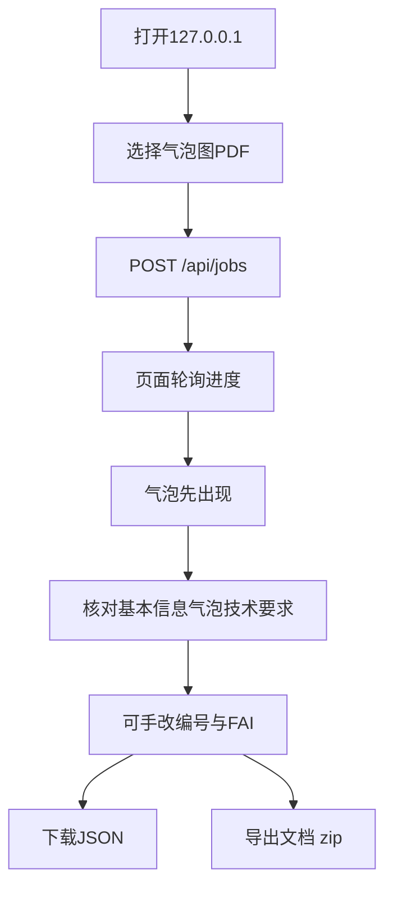
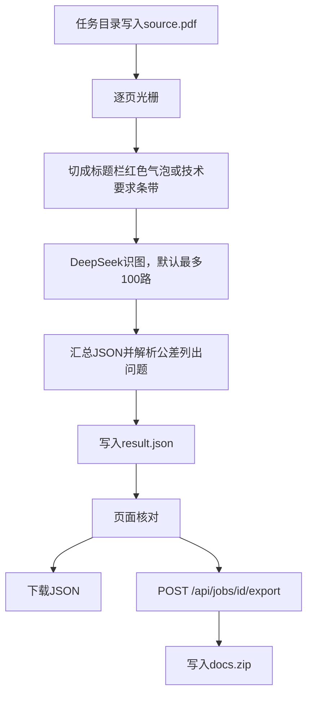
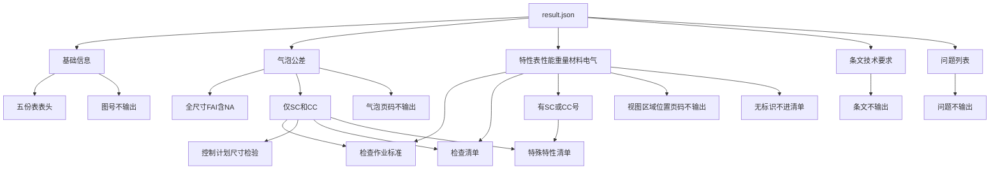

# 流程图

本文件描述当前项目怎么跑。业务规则仍只认 [`04-rule.md`](04-rule.md)。图按现在的代码画，不含尚未选定的提速做法。

## 同事路径

入口是本机网页。上传后页面轮询任务进度；气泡识图完成一条就出现一行 FAI，技术要求全部结束后再导出。需要时手改编号、描述和三个数值，确认后再下载 JSON 或导出五份 Excel。

## 程序路径

对应 `jobs.py` → `pipeline.run_pipeline`。导出走 `export_docs`。

`plan_pdf` 先光栅再切块；每块一张 PNG，`complete_vision` 只看这一块。识图默认最多 100 路并发。`merge_job` 解析公差并列出问题，结果写入任务目录的 `result.json`。

## JSON 每块写到哪儿

导出按下面处理。不输出的分支也画出来。

## 边界

只绑 `127.0.0.1`。模型不见整份 PDF。DeepSeek 密钥只从本机 `api-key.md` 读。不读字典、不画工序。
